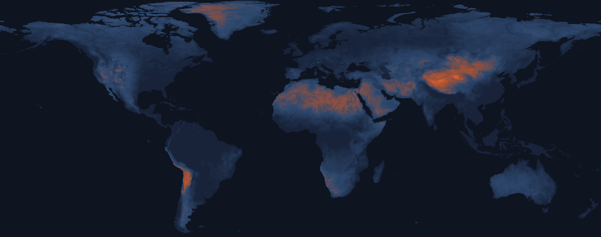
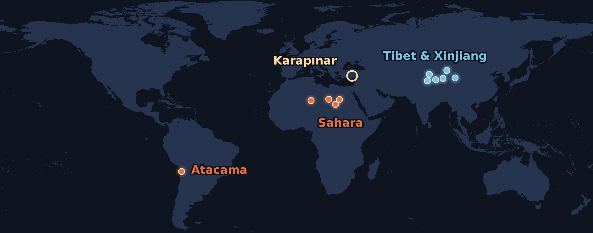
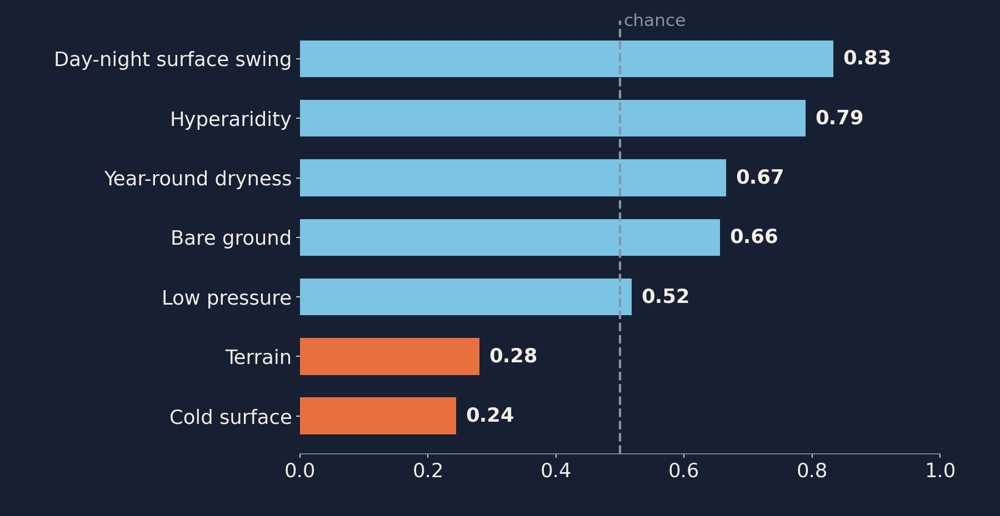
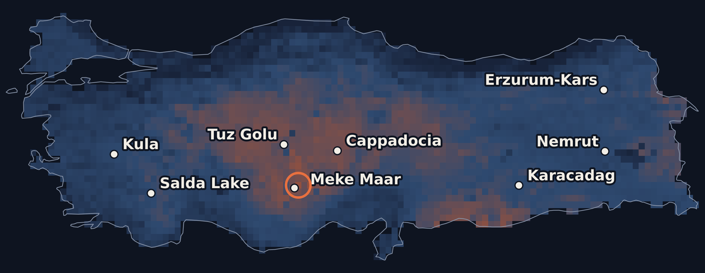

# TerraAnalog

**Every land cell on Earth, scored against the Moon and Mars, and checked
against the 31 places analog scientists already use.**

NASA Space Apps Challenge 2026 · *Identify Earth Locations that Analog the
Permanent Moon Base Locations and Mars* · Team ANKA, Ankara Local Event



*Mars desert analog score across 808,053 land cells. Gold is a strong match.*

---

## What we found

1. **The trait real analog sites share most is not dryness.** We scored the
   31 established Moon and Mars analog sites on each dimension separately.
   The strongest common trait of Mars desert analogs is the **day–night
   swing of the ground surface**, measured by NASA MODIS (AUC 0.83). Dryness
   comes second (0.79).

2. **Mars analog practice avoids the cold.** Established Mars desert
   analogs are *warmer* than ordinary land (AUC 0.24 for "cold surface").
   Field teams go to Death Valley, the Danakil and the Sahara. Mars averages
   about −63 °C at the surface.

3. **That gap points somewhere specific.** Ranked by Mars physics, the
   leading overlooked candidates are high, hyperarid deserts on the Tibetan
   Plateau and in Xinjiang. The top two, in Ngari and Hotan, have mean
   surface temperatures below freezing, and none of the top ten averages
   above 20 °C at the surface. The top three stay in the top ten in **100%**
   of 300 reruns with randomly perturbed weights. Rank the same way but
   ignore temperature, as practice does, and half of the top ten become hot
   deserts in the Sahara and the Atacama, all averaging above 27 °C.

4. **In Türkiye, one place leads every profile: the Karapınar basin** in
   Konya, beside the Meke Maar. It is the barest ground in the country, and
   the surface swings about 25 °C between day and night. For the lunar mare
   profile it is in the **top 10% of all land on Earth**. It is a young
   volcanic field of maars and cinder cones, and we found no study that uses
   it as a planetary analog.



*Blue: the top six candidates when Mars is treated as cold (physics). Orange:
the hot deserts that enter the top ten once temperature is ignored, as
practice does. Gold ring: Karapınar, Türkiye's best cell.*

---

## How it works

Earth cannot reach lunar or Martian values. Lunar noon is about +127 °C and
lunar night about −173 °C. Mars sits near −63 °C at about 6 hPa. So we never
match absolute numbers. For each dimension, the planetary conditions set a
**direction** (drier, barer, colder, larger day–night swing). Each cell is
then scored on how far along that direction it sits *among Earth's own land*.

1. **Features.** Nine variables per 10-arc-minute land cell (about 18 km):
   - **NASA MODIS Aqua land surface temperature**, monthly, day (13:30) and
     night (01:30), 2020–2024. From these we derive the mean surface
     temperature, the day–night swing, the coldest night and the yearly
     range.
   - **NASA MODIS Terra NDVI**, monthly, 2020–2024. We use the greenest
     month, so a desert that blooms after rain does not count as bare.
   - **WorldClim 2.1** precipitation and seasonality, and elevation (derived
     from NASA SRTM). Surface pressure comes from elevation via the
     barometric formula, and terrain roughness is the local standard
     deviation of elevation.
2. **Rank transform.** Each variable becomes its rank among all land cells,
   from 0 to 1. We use ranks because rainfall and roughness are strongly
   skewed.
3. **Score.** For each dimension, closeness = 1 − |rank − target| /
   (furthest reachable distance). The cell's score is the weighted mean over
   the dimensions measured there. A cell is left unscored if more than 25%
   of the weight is missing.
4. **Candidates.** We pick the best cells with greedy non-maximum
   suppression at 400 km. Established sites and everything within 300 km of
   them are excluded, as are the Antarctic and Greenland ice sheets.

### Getting MODIS without an account

NASA Earth Observations (NEO), the usual no-login source for global MODIS
grids, shut down in September 2026, and the science archives need an
Earthdata login. NASA GIBS serves the same products as images and publishes
the exact colour table for each layer. Every colour stands for one 0.6 K
temperature interval or one 0.01 NDVI interval, and no two intervals share
a colour. We request each month on our exact grid and decode it back
through that table. Across 180 images, every painted pixel matched a table
entry. Pixels that do not match are left missing, never guessed
([`src/modis_gibs.py`](src/modis_gibs.py)).

The switch mattered. In WorldClim air temperature, 95% of land has a
day–night range under 15.5 °C. At the ground surface measured by MODIS, the
top 5% of land exceeds 27 °C. That surface swing turned out to be the
strongest single signal in the validation.

---

## Validation

A method that cannot recognise the Atacama has no business proposing
anywhere else. We assembled 31 established analog sites, each with a
published reference ([`src/known_sites.py`](src/known_sites.py)). Each site is
tagged by *why* it was chosen:

- **environment**: cold, dry, high or barren
- **geology**: an impact crater, an anorthosite body, a mineral assemblage
- **operations**: a habitat or training ground

Climate and terrain cannot see geology, so we never pool the three groups
into one flattering number.

Each site is scored at its **nearest** land cell, never the best cell
nearby. The measure is ROC AUC against 50,000 random land cells: 0.5 is
chance, 1.0 is perfect. Each AUC comes with a bootstrap 95% interval. The
baseline is **rainfall alone**.

| Profile | Sites chosen for | n | AUC | 95% interval | Rainfall alone |
|---|---|---|---|---|---|
| Mars, polar ground ice | environment | 4 | **0.80** | 0.71–0.93 | 0.76 |
| Moon, south polar | environment | 3 | **0.81** | 0.76–0.87 | 0.77 |
| Mars, desert (physics) | environment | 8 | 0.66 | 0.53–0.79 | **0.79** |
| Mars, desert (practice, post hoc) | environment | 8 | 0.77 | 0.63–0.90 | 0.79 |
| Mars, desert | geology | 9 | 0.38 | 0.31–0.45 | 0.31 |
| Moon, mare | all (mostly geology) | 12 | 0.56 | 0.43–0.69 | 0.40 |

**Reading it honestly:**

- **The polar profiles work.** They rank the sites used for polar analog
  work above about 80% of Earth's land, and slightly beat rainfall alone.
  With only 3 and 4 sites, the intervals are wide.
- **The Mars desert profile, as designed from physics, loses to rainfall
  alone.** This is the result that led to finding 2 above. We dropped one
  dimension at a time and re-scored: removing *cold surface* lifts AUC from
  0.66 to 0.77, while every other dimension holds or adds value. The
  profile agrees with practice on every axis except temperature.
- **The "practice" variant was built after seeing that result,** so its own
  AUC is optimistic. We keep it only to make the gap visible: a site that
  ranks high under physics but not under practice is a cold desert that
  current practice is not looking at.
- **Sites chosen for geology score at or below chance.** Ries, Sudbury,
  Mistastin and Rio Tinto are in wet, green places, and they were chosen for
  rocks this method cannot see. That is a limit of the method, and we
  report it as one.



*AUC of each dimension alone, for the 8 Mars desert sites chosen for their
environment. Below the dashed line, established sites systematically avoid
the trait.*

### Robustness to our own weights

The weights are judgement calls, so we tested how much the answer depends on
them. Every weight was multiplied by an independent random factor between
0.5 and 1.5, and the search was rerun 300 times. A candidate's **stability**
is the share of runs in which some top-ten pick lands within 250 km of it.
The top three Mars desert candidates and the top three lunar mare candidates
score 100%. Candidates below about 60% are artefacts of our weighting, and
the app labels them that way.

---

## Candidates

Full tables, with stability, strongest and weakest dimension and
coordinates: [`docs/results/candidates.csv`](docs/results/candidates.csv).

**Mars desert, physics (cold counts).** Ngari Prefecture, western Tibet:
65 mm of rain a year, about −1 °C mean surface temperature, a 29 °C
day–night swing, essentially bare (stability 100%). Hotan Prefecture on the
Xinjiang side of the Kunlun Shan, −2 °C (100%). Dulan County at the eastern
edge of the Qaidam Basin, which is warmer at +13 °C (100%). Shuanghu County,
Nagqu, −5 °C (84%).

**Moon, equatorial mare.** The hyperarid core of the Sahara (Murzuq and
Kufra in Libya, the Red Sea governorate of Egypt) and coastal Peru (Ica),
all at 100% or close. **Tibesti** in Chad is in the top 0.01% of all land
for this profile. It does not appear in the ten-item list only because
Kufra and Murzuq outrank it within 400 km. NASA's Earth Observatory already
compares Tibesti's volcano Emi Koussi with the Martian volcano Elysium Mons,
on shape alone. Our search reaches the same massif from climate and
terrain, which never look at shape.

**Mars polar and Moon south polar.** The Canadian Arctic Archipelago leads
both profiles once Devon Island's surroundings are excluded. Hotan, on the
Xinjiang side of the Kunlun, reappears in the Mars polar list at rank 2: a
cold desert that fits two Martian environments at once.

**A caution about "overlooked".** Here it means "not on our list of 31
sites and more than 300 km from any of them". The Pampa del Tamarugal,
which ranks high for the lunar mare and for practice-style Mars work, is
the northern Atacama, just outside that radius. The Tibetan Plateau already
has some analog research around the Qaidam Basin. We have not reviewed the
literature for every candidate.

---

## Case study: Türkiye



We ran the same search inside Türkiye's borders. For every Moon and Mars
profile, the best cell in the country is the same place: **37.75° N,
33.75° E, the Karapınar basin**, about 12 km from the Meke Maar.

| | Karapınar (best cell) |
|---|---|
| Lunar mare score | 0.69, top **10%** of all land on Earth |
| Day–night surface swing | 25.1 °C, closeness 0.91 |
| Greenest-month NDVI | 0.09, the barest ground in Türkiye |
| Rain | 388 mm/yr, closeness 0.45 (the weakest link) |
| Mars desert score | 0.58, top 36% |

**Why go there.** The climate signal comes from the data alone, and the
geology adds independent support. Karapınar is a Quaternary monogenetic
volcanic field of cinder cones, maars and lava flows. Its rocks are basaltic
to andesitic (Gall et al., 2021, *Lithos*). It is a short drive from Konya,
which matters for operations. In a web search we found no study that uses
it as a lunar or Martian analog. Practical uses:

- Rover traverse and slope tests on maar crater walls and rims.
- Instrument trials on young cinder and lava surfaces.
- Field-geology training in a monogenetic volcanic field. This is the kind
  of setting used for astronaut training at Kilbourne Hole and in the San
  Francisco Volcanic Field, both on our validation list.

**Where it breaks.** At 388 mm a year it is far wetter than any lunar
analog should be. Its lavas are only partly basaltic, while the lunar maria
are basalt. Parts of the basin are farmed. It is a regional analog for
training and testing, not a world-class climatic one.

**Salda Lake**, Türkiye's established Mars analog for Jezero crater, ranks
low here (top 56% for the Mars desert profile). That is expected. Salda was
chosen for its carbonate mineralogy, which climate data cannot see. The two
approaches complement each other: ours finds environments, while
mineralogy finds Salda.

Tables: [`docs/results/turkiye_top.csv`](docs/results/turkiye_top.csv),
[`docs/results/turkiye_places.csv`](docs/results/turkiye_places.csv).

---

## What went wrong along the way

- **First run: every Mars candidate was in interior Antarctica.** It is the
  coldest, driest land on Earth, so a naive ranking returns nothing else.
  The challenge names Antarctica as already well studied, and its interior
  is effectively unreachable for field campaigns, so the ice sheets are now
  masked when searching for new candidates.
- **The first version used air temperature.** It produced a headline
  candidate list that changed substantially once we switched to MODIS
  surface temperature. We report the current list, not the more convenient
  one.
- **Our physics-based Mars profile lost to rainfall alone** in validation.
  Rather than tune the weights until it won, we kept it, measured why it
  lost, and made the reason the main finding.

## What this is not

- **Not a site survey.** At about 18 km per cell, the output is a shortlist
  of regions, not coordinates to land on.
- **No geology or mineralogy layer.** The geology-chosen validation sites
  score at chance for exactly this reason. ASTER emissivity (silica versus
  basalt) is the obvious next layer.
- **Earth cannot reproduce** gravity, vacuum, radiation or atmospheric
  chemistry. Each profile states this instead of scoring it.
- **Lunar targets come from published values,** not raw LRO Diviner
  products. Deriving them directly is a next step.

---

## Running it

```bash
pip install -r requirements.txt
python scripts/download_data.py    # WorldClim (~51 MB) + Natural Earth boundaries
python scripts/build_modis.py      # 180 MODIS months from NASA GIBS, ~2 min
python src/earth_features.py       # builds the 808,053-cell grid
python scripts/run_analysis.py     # validation, ablation, candidates, stability
python scripts/turkiye_case.py     # Türkiye case study
python scripts/render_figures.py   # figures in docs/figures
streamlit run app.py
python -m pytest tests             # 17 tests
```

The raw data is not in this repository. WorldClim's licence does not allow
redistribution, so the scripts fetch everything from the original sources.

## Structure

```
app.py                     Streamlit app: search, validation, gap, Türkiye
src/modis_gibs.py          MODIS from NASA GIBS, decoded via colour tables
src/earth_features.py      Global land grid: WorldClim + MODIS
src/planet_profiles.py     Moon and Mars target environments, with rationale
src/analog.py              Rank transform, scoring, masking, candidates
src/known_sites.py         31 established analog sites with references
src/validation.py          ROC AUC, bootstrap intervals, rainfall baseline
src/sensitivity.py         Monte Carlo weight perturbation
src/turkiye.py             Türkiye case study
src/countries.py           Natural Earth point-in-polygon
src/placenames.py          Reverse geocoding (OpenStreetMap Nominatim)
scripts/                   Download, build, analysis and figure scripts
docs/results/              Every number quoted above, as CSV
docs/figures/              Every figure above
tests/                     Unit tests for the arithmetic
```

## Data and references

- NASA MODIS Aqua Land Surface Temperature (Monthly) and Terra NDVI
  (Monthly), via NASA Global Imagery Browse Services (GIBS).
  <https://www.earthdata.nasa.gov/engage/open-data-services-software/earthdata-developer-portal/gibs-api>
- Fick, S.E. and Hijmans, R.J. (2017), WorldClim 2, *Int. J. Climatology*
  37(12): 4302–4315. <https://worldclim.org>
- NASA Earth Observatory, *Emi Koussi Volcano, Chad*.
  <https://earthobservatory.nasa.gov/IOTD/view.php?id=3023>
- Gall, H. et al. (2021), Post-delamination magmatism in south-central
  Anatolia, *Lithos*.
- Natural Earth admin-0 boundaries (public domain); OpenStreetMap Nominatim
  (© OpenStreetMap contributors, ODbL).
- References for all 31 validation sites are in
  [`src/known_sites.py`](src/known_sites.py).

## Use of Super Intelligence (SI)

This project relied heavily on an SI coding assistant (Claude, by
Anthropic). The assistant proposed the core method, wrote the pipeline,
scoring, validation and app code, and drafted this README. The team chose
the challenge, directed each step and decided what to keep. Every number
here comes from running the code on the data named above; none was
generated by the SI tool. All figures are plotted from our own results; no
SI-generated images are used.
